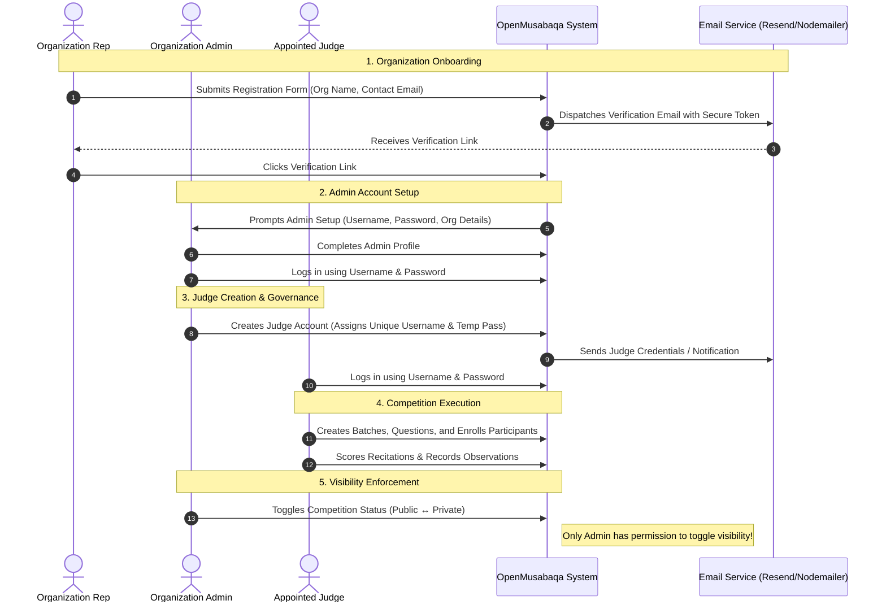

# OpenMusabaqa – Platform Changes & Evolution Plan

This document outlines the architectural roadmap, deliverables, database schema evolution, authentication workflows, email infrastructure, and implementation phases for **OpenMusabaqa**.

---

## 1. Executive Summary & Vision

**OpenMusabaqa** is evolving from a single-instance Quran competition judge-and-participant tool into an end-to-end, multi-tenant Quran competition and community platform.

### Core Additions:
1. **Public-Facing Landing Page (`/apps/web`)**: A high-impact web presence featuring portals access, organization registration, public leaderboards, competition discovery, and institutional story.
2. **Super-Admin Console with CMS (`/apps/admin`)**: A centralized management hub with dynamic CMS for landing page content, competition oversight, organization verification, and bulk email broadcast capabilities.
3. **Dual Email Architecture**:
   - **Transactional**: Nodemailer / Resend for email verification, judge onboarding, password resets, and critical alerts.
   - **Bulk Communications**: Brevo (formerly Sendinblue) for targeted participant mailings, newsletters, and announcements.
4. **Structured Multi-Tier Auth & Governance**: Clear boundary enforcement between Super-Admins, Organization Admins, Judges, and Contestants.
5. **Project Rebranding**: Full alignment under the name **OpenMusabaqa**.

---

## 2. System Architecture & Workspaces

The project transitions to a unified monorepo / multi-app layout:

```
OpenMusabaqa/
├── apps/
│   ├── web/                     # Public-facing landing page, public competitions, leaderboards, registration
│   │   ├── app/
│   │   │   ├── (public)/        # Landing page sections, about, competitions, leaderboards
│   │   │   ├── register/        # Organization registration & onboarding
│   │   │   └── verify-email/    # Token-based verification landing
│   │   └── components/
│   └── admin/                   # Super-Admin Console & CMS
│       ├── app/
│       │   ├── login/           # Admin & Super-admin authentication
│       │   ├── cms/             # Dynamic CMS management for landing page
│       │   ├── competitions/    # Competition creation, public/private toggles
│       │   ├── organizations/   # Organization approval & verification
│       │   ├── users/           # User management (Admins, Judges)
│       │   └── email/           # Email broadcaster (Brevo & Resend/Nodemailer)
│       └── components/
├── packages/                    # (Or shared src/ in Next.js structure)
│   ├── database/                # Prisma schema, migrations, client
│   ├── emails/                  # React Email / HTML templates
│   └── config/                  # Shared Tailwind, TypeScript, ESLint
├── src/                         # Existing Judge & Participant PWA portals (or /apps/live)
│   ├── app/
│   │   ├── judge/               # Real-time judging portal
│   │   ├── participant/         # Question selection portal
│   │   └── results/             # Live display board
└── README.md                    # Root platform documentation
```

---

## 3. Deliverables Breakdown

### Deliverable 1: Public-Facing Landing Page (`/apps/web`)

A responsive, high-performance web experience built with React/Next.js featuring a gold & turquoise Islamic design system:

| Section | Description | CMS Managed |
| :--- | :--- | :---: |
| **1. Hero & Portal Accessibility** | Compelling headline, call-to-actions, and quick entry buttons to Participant Portal, Judge Portal, and Results Portal. | ✅ Yes |
| **2. Vision & Milestones** | Interactive timeline highlighting the mission, milestones achieved, and strategic goals for Quran competitions worldwide. | ✅ Yes |
| **3. Statistics** | Animated metrics counter (total competitions hosted, participating reciters, questions recited, registered organizations). | ✅ Yes |
| **4. Testimonies** | Testimonials from international judges, organizers, scholars, and contestants. | ✅ Yes |
| **5. Team (3 Founders)** | Founder profiles, bios, roles, social links, and vision quotes. | ✅ Yes |
| **6. Gallery** | Rich media gallery showcasing past competition highlights, ceremonial awards, and reciter spotlights. | ✅ Yes |
| **7. Partners & Sponsors** | Logo wall and tier badges for participating Islamic institutions, academic partners, and event sponsors. | ✅ Yes |
| **8. Call to Action (CTA)** | High-conversion blocks inviting prospective sponsors, institutional partners, and donors. | ✅ Yes |
| **9. Newsletter** | Email capture form synced with Brevo contact lists for bulletins and competition updates. | ✅ Yes |
| **10. Public Competitions List** | Filterable index of ongoing, upcoming, and past competitions with search, date tags, and status badges. | Live DB |
| **11. Public Leaderboards** | Read-only public leaderboard view allowing community members to inspect verified scores and winners. | Live DB |
| **12. Registration Form** | Intuitive multi-step onboarding form for organizations requesting an OpenMusabaqa tenant. | Form / API |

---

### Deliverable 2: Super-Admin Console (`/apps/admin`)

The Super-Admin console acts as the mission control for the entire platform:

1. **CMS Engine (CRUD for Landing Page)**:
   - Live editing and toggling of all 8 CMS-driven landing page sections.
   - Rich-text editor for Vision & Milestones.
   - Image upload & media management for Gallery, Team, and Partner logos.
   - Drag-and-drop reordering for testimonials and team members.
2. **Competition & Organization Management**:
   - Review incoming Organization registrations with one-click approval / rejection.
   - Global view of all competitions across all organizations.
   - **Privacy Governance**: Exclusive authority to toggle competitions between `PUBLIC` and `PRIVATE`.
3. **User Management**:
   - Super-Admin, Org-Admin, and Judge directory.
   - Role reassignment, suspension, and password resets.
4. **Email Communications Center**:
   - **Selected Recipients**: Send targeted updates to specific judges, org admins, or participants.
   - **Bulk Campaigns**: Dispatch broadcast emails using Brevo (e.g., newsletters, major platform updates, competition invitations).
   - Delivery logging and status tracking.

---

### Deliverable 3: Auth Flow & Role-Based Access Control (RBAC)

A structured hierarchy ensuring organization sovereignty and strict competition integrity:



#### Roles & Permissions Matrix:

| Capability | Super-Admin | Org-Admin | Judge | Participant / Public |
| :--- | :---: | :---: | :---: | :---: |
| Edit Landing Page CMS | ✅ Full | ❌ None | ❌ None | ❌ None |
| Approve Organizations | ✅ Full | ❌ None | ❌ None | ❌ None |
| Toggle Public/Private Competition | ✅ Full | ✅ Own Org | ❌ Denied | ❌ Denied |
| Create Judges | ✅ Full | ✅ Own Org | ❌ Denied | ❌ Denied |
| Create Batches & Questions | ✅ Full | ✅ Own Org | ✅ Assigned Comp | ❌ Denied |
| Add / Import Participants | ✅ Full | ✅ Own Org | ✅ Assigned Comp | ❌ Denied |
| Score Recitations | ❌ Read | ❌ Read | ✅ Active Comp | ❌ Denied |
| View Public Leaderboard | ✅ Yes | ✅ Yes | ✅ Yes | ✅ Public Only |

---

### Deliverable 4: Email System Architecture

A dual-provider approach optimizing for deliverability and scale:

```
                         ┌────────────────────────┐
                         │   OpenMusabaqa Core    │
                         └───────────┬────────────┘
                                     │
                 ┌───────────────────┴───────────────────┐
                 ▼                                       ▼
    [ Transactional Engine ]                [ Bulk Mailer Engine ]
    • Provider: Resend / Nodemailer         • Provider: Brevo (Sendinblue API)
    • Purpose:                              • Purpose:
      - Org verification link                 - Bulk competitor alerts
      - Judge credential dispatch             - Newsletter broadcasts
      - Security & password resets            - Sponsor & partner outreach
      - Real-time turn notifications          - Post-event recap summaries
```

#### Service Interface:
- `sendVerificationEmail(to, token, orgName)`
- `sendJudgeInviteEmail(to, username, tempPassword, competitionName)`
- `sendBulkAnnouncement({ recipients, subject, templateId, parameters })`
- `subscribeToNewsletter(email, source)`

---

## 4. Prisma Schema Extensions

The following models will be introduced or enhanced in `prisma/schema.prisma`:

```prisma
// Multi-tenancy & Organization
model Organization {
  id          String        @id @default(cuid())
  name        String
  slug        String        @unique
  contactEmail String       @unique
  isVerified  Boolean       @default(false)
  verifiedAt  DateTime?
  logoUrl     String?
  createdAt   DateTime      @default(now())
  updatedAt   DateTime      @updatedAt

  users        User[]
  competitions Competition[]
}

// Authentication & Users
enum Role {
  SUPER_ADMIN
  ORG_ADMIN
  JUDGE
}

model User {
  id             String        @id @default(cuid())
  username       String        @unique
  email          String?       @unique
  passwordHash   String
  role           Role          @default(JUDGE)
  organizationId String?
  organization   Organization? @relation(fields: [organizationId], references: [id])
  
  createdAt      DateTime      @default(now())
  updatedAt      DateTime      @updatedAt
}

// Competition Entity
model Competition {
  id             String        @id @default(cuid())
  title          String
  slug           String        @unique
  description    String?
  isPublic       Boolean       @default(false) // Only Admin can toggle
  startDate      DateTime?
  endDate        DateTime?
  organizationId String
  organization   Organization  @relation(fields: [organizationId], references: [id])
  
  groups         Group[]
  createdAt      DateTime      @default(now())
  updatedAt      DateTime      @updatedAt
}

// CMS Models for Landing Page
model CmsHero {
  id          String   @id @default("default")
  badge       String?
  title       String
  subtitle    String
  primaryCta  String
  primaryLink String
  secondaryCta String?
  secondaryLink String?
  updatedAt   DateTime @updatedAt
}

model CmsMilestone {
  id          String   @id @default(cuid())
  year        String
  title       String
  description String
  order       Int      @default(0)
}

model CmsStat {
  id          String   @id @default(cuid())
  label       String
  value       String
  suffix      String?
  icon        String?
  order       Int      @default(0)
}

model CmsTestimonial {
  id          String   @id @default(cuid())
  name        String
  role        String
  avatarUrl   String?
  quote       String
  rating      Int      @default(5)
  order       Int      @default(0)
}

model CmsTeamMember {
  id          String   @id @default(cuid())
  name        String
  role        String
  bio         String
  avatarUrl   String?
  twitter     String?
  linkedin    String?
  order       Int      @default(0)
}

model CmsGalleryItem {
  id          String   @id @default(cuid())
  title       String
  caption     String?
  imageUrl    String
  featured    Boolean  @default(false)
  createdAt   DateTime @default(now())
}

model CmsPartner {
  id          String   @id @default(cuid())
  name        String
  logoUrl     String
  website     String?
  tier        String   @default("partner") // gold, silver, partner
  order       Int      @default(0)
}

model NewsletterSubscriber {
  id           String   @id @default(cuid())
  email        String   @unique
  source       String   @default("landing_page")
  syncedBrevo  Boolean  @default(false)
  subscribedAt DateTime @default(now())
}
```

---

## 5. Phased Implementation Roadmap

### Phase 1: Rebranding & Repository Foundations
- [x] Rename project configuration and metadata to **OpenMusabaqa**.
- [x] Update root `README.md` with complete platform description.
- [x] Create comprehensive `CHANGES_PLAN.md` specification.
- [ ] Configure project structure for `/apps/web` and `/apps/admin`.

### Phase 2: Database Schema & Authentication Core
- [ ] Update `prisma/schema.prisma` with Organization, User (RBAC), Competition, and CMS models.
- [ ] Implement password hashing (Argon2id/bcrypt) and JWT/session management.
- [ ] Build username-based authentication endpoints for Admins and Judges.
- [ ] Implement Email Verification token flow using Resend/Nodemailer.

### Phase 3: Public Landing Page (`/apps/web`)
- [ ] Develop responsive layout with turquoise and gold theme.
- [ ] Implement the 12 core sections (Hero, Vision, Stats, Testimonies, Team, Gallery, Partners, CTA, Newsletter, Public Competitions, Public Leaderboards, Registration).
- [ ] Connect sections to CMS API endpoints with server-side caching / ISR.
- [ ] Implement Organization Registration form with validation.

### Phase 4: Super-Admin Console (`/apps/admin`)
- [ ] Build Super-Admin dashboard with authentication protection.
- [ ] Build CMS Editor interfaces for all 8 landing page sections (CRUD).
- [ ] Build Organization approval workflow.
- [ ] Build Competition manager with public/private toggle authorization.
- [ ] Implement Judge creation tool with automatic credential generation.

### Phase 5: Email Integration & Broadcaster
- [ ] Configure Resend / Nodemailer transactional transport.
- [ ] Configure Brevo API integration for list sync and bulk campaigns.
- [ ] Build UI in `/apps/admin` for drafting and dispatching bulk emails.

### Phase 6: QA, PWA Hardening & Production Deployment
- [ ] End-to-end testing of full auth and scoring workflows.
- [ ] Verify PWA offline capabilities and responsiveness across mobile & desktop.
- [ ] Production environment deployment.
